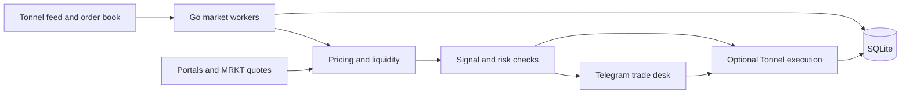

# Floorline

**A self-hosted Go trading desk for Telegram Gifts.** Watch Tonnel listings and completed sales, price gifts against the live market, and manage buying, relisting, and inventory from Telegram.

[Документация на русском](docs/operations.ru.md)

## From listing to exit

1. **Watch the market.** A WebSocket feed and fallback pollers track new asks, reprices, and completed sales. A standing-book scanner finds opportunities even when no new listing arrives.
2. **Price the individual gift.** Floorline values a collection and model together, then checks recent sale velocity, ask depth, and attribute premiums. Optional Portals and MRKT quotes add cross-market context.
3. **Decide in Telegram.** A trade card shows the entry cost, fast and patient exit estimates, and the checks that passed or failed. Manual buys require a second tap to confirm.
4. **Execute within limits.** Optional unattended buying checks market freshness, liquidity, position and spend limits, and the live quote before submitting an order. Automatic relisting is a separate toggle. SQLite records signals, fills, and position history for review.

## What makes the pricing different

When you buy the cheapest listing, that ask leaves the book. Floorline removes the candidate and your own listings from the comparison, then uses the next competing ask to estimate what it would take to exit quickly. Its fair-value estimate also weighs completed sales, book depth, and traits. This gives the operator two useful numbers: a competitive ask for a fast listing and an estimate of what the gift is worth.

## Telegram controls

| Command | What it shows or does |
| --- | --- |
| `/scan Plush Pepe 3-5 25` | Scan standing asks in a collection and price range |
| `/val <gift_id>` | Show the valuation and decision checks for a listing |
| `/trade` | Follow a shortlist of liquid models on a live Telegram board |
| `/portfolio` · `/pnl` | Review positions, proposed actions, and P&L in GRAM and USD |
| `/autobuy` · `/limits` | Inspect execution state, blockers, and risk limits |

## Architecture



**Stack** · Go 1.26 · SQLite · WebSockets · Telegram Bot API · Docker Compose

## Quick start

Run from the repository root with Go 1.26.2 or newer. Set `TELEGRAM_BOT_TOKEN`, `TELEGRAM_OWNER_ID`, and `TONNEL_AUTH_DATA` in `.env`.

```sh
cp .env.example .env
${EDITOR:-vi} .env
go build -o floorline ./cmd/floorline
./floorline smoke
./floorline run
```

A fresh database starts in shadow mode and unattended buying starts disarmed. Start with `/status` and `/scan` in the bot. The Russian operations guide covers marketplace sessions, history backfill, risk limits, and deployment.

```sh
go test ./...
```
